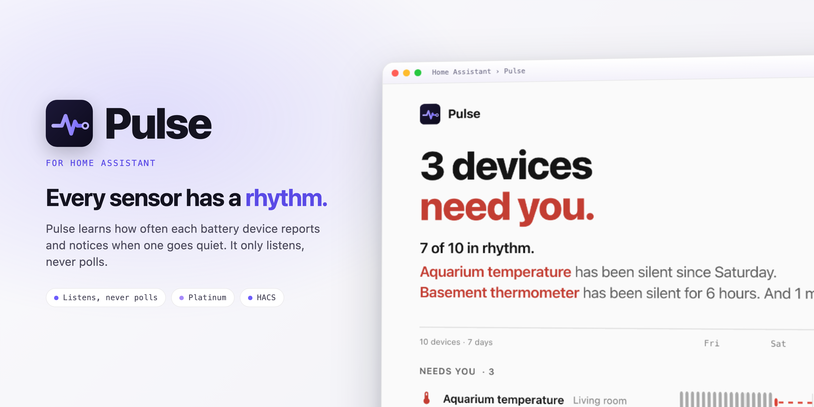
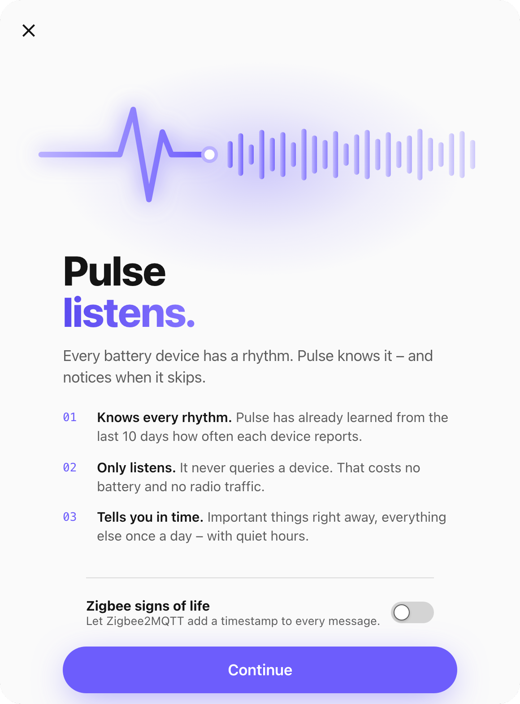

<div align="center">

<picture>
  <source media="(prefers-color-scheme: dark)" srcset="docs/images/readme-title-dark.png" />
  
</picture>

<p>Pulse learns how often each battery device reports and notices when one goes quiet.<br/>
It only listens, never polls. No battery wasted, no automation left guessing.</p>

[](https://github.com/SH1FT-W/pulse/releases/latest)
[](https://www.home-assistant.io)
[](https://hacs.xyz)
[-6D5DFC?style=flat-square&labelColor=0E0D14)](custom_components/pulse/quality_scale.yaml)
[](LICENSE)

<p><a href="https://sh1ft-w.github.io/pulse"><b>Website</b></a> &nbsp;·&nbsp; <a href="#new">New</a> &nbsp;·&nbsp; <a href="#how">How it decides</a> &nbsp;·&nbsp; <a href="#notify">Notifications</a> &nbsp;·&nbsp; <a href="#zigbee">Zigbee</a> &nbsp;·&nbsp; <a href="#automate">Automations</a> &nbsp;·&nbsp; <a href="#install">Install</a> &nbsp;·&nbsp; <a href="CHANGELOG.md">Changelog</a></p>

</div>

<br/>

<a id="new"></a>
<sub><b>JUST ARRIVED</b></sub>
## Forecasts, calm clouds, and new numbers.

The latest releases teach Pulse to look ahead, to tell a cloud outage from a dead battery, and to count versions by the calendar.

<picture>
  <source media="(prefers-color-scheme: dark)" srcset="docs/images/readme-cards-new-dark.png" />
  
</picture>

Every change, release by release, in the [changelog](CHANGELOG.md).

<br/>

<a id="why"></a>
<sub><b>THE PROBLEM</b></sub>
## The battery said 94 %. The door said nothing.

When a sensor dies, Home Assistant keeps showing the last state it heard. The door stays "closed", the leak sensor stays "dry", the battery stays at 94 %. Nobody notices until an automation misfires a week later.

Pulse looks at the one thing that never lies: **how often the device talks.** It is a Home Assistant integration that watches every battery-powered device for you, learns how often each one normally reports and tells you when one stops.

- **0 polls.** Pulse never asks a device anything, so it costs no battery and no airtime.
- **10 days** of recorder history are read on the first start. No learning week.
- **1 click** to set up. Pulse finds every device with a battery sensor itself.

<p align="center">


<br/><sub>A headline that puts problems first, a heartbeat calendar per device, the battery with its forecast. On the phone the strips glow in the dark.</sub>
</p>

<br/>

<a id="how"></a>
<sub><b>HOW IT DECIDES</b></sub>
## Four words. Always with a reason.

From the gaps between reports Pulse learns a typical gap and a longest normal gap for every device. The current silence is compared with both. Important devices such as locks, leak and smoke sensors get tighter limits. Every status comes with a reason in plain words: *Silent for 5 days. Usually reports every 30 minutes.*

Pulse needs about seven reports from a device to know its rhythm. With recorder history this is there right away. Devices the recorder doesn't record start as *Learning*.

| Status | Normal device | Important device (lock, leak, smoke, gas) |
|:--|:--|:--|
| **Good** | Reporting as usual | Reporting as usual |
| **Watch** | 2.5 × typical gap (at least 45 min) | 2 × (at least 30 min) |
| **Check** | 4 × typical gap (at least 2 h) | 3 × (at least 1 h) |
| **Failed** | 8 × typical gap (at least 6 h) | 5 × (at least 3 h) |

Unreachable devices (Zigbee2MQTT availability, Matter, entities that are unavailable) become *Check* after 20 minutes and *Failed* after 2 hours (important devices: 10 minutes and 1 hour). A battery at 20 % or less is *Watch*, at 10 % or less *Check*. A device that only reports "battery low" becomes *Check* when it does. Failed devices show up under *Settings → Repairs* and disappear on their own when they report again.

- **Restart echoes don't count.** Values that Zigbee2MQTT or Home Assistant replay after a restart are never taken as a sign of life.
- **Honest about gaps.** The time Home Assistant was not running is hatched in the panel and never counts as silence. After a start, a device that has not reported yet waits for one usual gap as *Watch*, without a notification.
- **One stray report is not a recovery.** After a long silence, one or two stray reports don't count. Two reports in the usual rhythm do, and so does a real action such as a door opening.
- **Cross-check.** Pair devices that fire together, such as a lock and its door contact. If one keeps reporting and the other falls silent, Pulse notices early. Pulse also suggests partners on its own; accept or dismiss them in the device sheet.
- **Battery changes.** Detected from a voltage or level jump or a Zigbee re-join, with a history per device. Pulse knows the battery type of common models. NiMH rechargeables are exempt from percentage rules because their percentage says nothing.
- **Battery forecast.** From Home Assistant's long-term statistics Pulse estimates how long a battery will last, as a rough range. The battery card lists what is due in the next eight weeks.
- **A panel that reads like a dashboard.** One headline that puts problems first, a seven day rhythm strip per device, a heartbeat calendar per device, and the notification settings. Important devices carry a star.

A few more reasons have their own wording:

- **Battery entity missing.** The battery sensor has been unavailable for a day while the rest of the device keeps reporting. Pulse says so instead of guessing a level.
- **"Battery low" wins.** If a device has its own "battery low" sensor and it is on, that counts, even when the percentage still looks fine.
- **Radio, but no values.** Zigbee2MQTT still counts messages from the device, but nothing new arrives in Home Assistant. This is at most *Check*, never *Failed*, and it does not count as a sign of life.
- **Cloud devices.** For cloud integrations only a real change of value counts as a sign of life, because the cloud's polling repeats old values. A single cloud device becomes *Failed* after a day at the earliest. When several devices of one cloud integration (Netatmo, Ring and others) go quiet together, that is the cloud, not the batteries: Pulse shows them as *Watch* and sends one message.

After *Battery replaced* the silence counts from the replacement, and the device shows "waiting for the first report" until it reports again.

<details>
<summary><b>Known limitations</b></summary>
<br/>

- **Only devices with a battery entity.** Pulse finds devices through `device_class: battery` (a percentage or a "battery low" switch). Devices without one are not monitored.
- **Quiet by design is hard to tell from dead.** A device that only reports when something happens, with no periodic battery report, has no rhythm. Pulse learns the longest normal gap, but a door that is rarely opened stays in *Learning* or *Watch* longer: after two days without a report it becomes *Watch* (no notification), only after a week *Check*.
- **Stuck values are not silence.** A sensor that keeps reporting the same wrong value counts as alive. Pulse watches whether a device talks, not whether what it says is right.
- **Zigbee2MQTT `last_seen` in payloads.** If the bridge option was once on and is now off, Zigbee2MQTT keeps sending a frozen timestamp. Pulse ignores `last_seen` unless the option is on.
- **History needs the recorder.** Entities excluded from the recorder start in *Learning* after every install.
- **Notifications only through the Companion app** (`notify.mobile_app_*`). For anything else, use the `pulse_device_status_changed` event in an automation.
- **NiMH rechargeables** never get a battery warning from their percentage, only from silence.
- **Cloud integrations come from a fixed list.** Pulse knows the common cloud integrations (Netatmo, Ring, Nest, tado and others). A cloud integration that is not on the list is treated like a local one.
- **Forecasts need usable percentages.** Pulse only forecasts when the battery level falls in fine steps over at least two weeks. Coarse levels (100, 50, 0), flat or noisy values, NiMH rechargeables and devices that only report "battery low" get no forecast, and the panel says why.

</details>

<br/>

<a id="notify"></a>
<sub><b>NOTIFICATIONS</b></sub>
## Tells you once. At a good time.

Straight to the Companion app (`notify.mobile_app_*`). Failures right away, the rest in one daily summary, with quiet hours and "only when someone is home". Never the same message twice. As long as you don't change the recipient list, new phones are added automatically.

<picture>
  <source media="(prefers-color-scheme: dark)" srcset="docs/images/readme-cards-notify-dark.png" />
  
</picture>

If Home Assistant was down at summary time, the summary is sent up to two hours late. A notification about a single device names its room first, unless the device name already contains it.

**Your own words.** Under *Notifications → Texts* you can rewrite the title and text of each kind of notification (Failed, Check, Battery, Back again). You start from Pulse's sentence and see a live preview on one of your devices. Placeholders: `{name}`, `{area}`, `{reason}`, `{model}`, `{manufacturer}`, `{integration}`. Empty values vanish together with their " · ".

**Beta: mains-powered devices.** Off by default. Turn on *Notifications → Beta → Watch mains-powered devices* and Pulse also watches devices without a battery from local integrations (ZHA, Zigbee2MQTT, Z-Wave, Matter, Hue, deCONZ, ESPHome, Shelly, Tasmota, TP-Link, WLED and a few more). They hang too: Pulse tells you when one is no longer reachable, or when one that usually reports regularly (a plug with a power meter, a Zigbee router) goes silent. A lamp that only reports when it is switched is fine as long as it is reachable.

Pulse speaks English, German, French, Spanish and Dutch.

<p align="center">
  
</p>

<br/>

<a id="zigbee"></a>
<sub><b>ZIGBEE2MQTT</b></sub>
## One switch. Every heartbeat.

Many sensors only send when a value changes. With one switch Pulse turns on `last_seen` and availability in Zigbee2MQTT, so it also sees the reports that changed nothing.

Pulse listens to `zigbee2mqtt/#` (the base topic can be changed in the panel). With one switch it enables two bridge options: `last_seen`, a timestamp on every message so Pulse also sees reports without a new value, and availability. Note that with availability turned on, Home Assistant shows silent Zigbee devices as unavailable, and Zigbee2MQTT pings mains powered routers.

- **A second switch** turns on the health check of Zigbee2MQTT 2.x. The bridge then publishes a message counter per device, and Pulse notices devices that keep talking to the network but no longer send values.
- **Only after you confirm.** These two bridge options are the only things Pulse ever writes, and only after you confirm them in the panel. You find them in the welcome sheet and under *Notifications → Zigbee2MQTT*. Battery devices send nothing extra.
- **Patient with the broker.** If the MQTT broker starts later than Home Assistant, Pulse keeps trying every five minutes.

<p align="center">
  <picture>
    <source media="(prefers-color-scheme: dark)" srcset="docs/images/welcome.png" />
    
  </picture>
  <br/>
  <sub><b>Welcome</b>: what Pulse does, one switch for Zigbee signs of life</sub>
</p>

<br/>

<a id="automate"></a>
<a id="entities-events-and-actions"></a>
<sub><b>ENTITIES, EVENTS, ACTIONS</b></sub>
## Plays well with your automations.

Every monitored device gets diagnostic entities on the device itself. Status changes fire an event, and a handful of actions let automations do what the panel does.

**Entities**, attached to the device itself as diagnostic entities:

| Entity | State | Attributes |
|:--|:--|:--|
| `binary_sensor.<device>_pulse_problem` | on for Check or Failed | `status`, `reason_key` |
| `sensor.<device>_pulse_status` | `ok`, `learning`, `watch`, `check`, `failed` | `reason_key`, `silent_since`, `typical_interval` (s), `critical`, `snoozed_until` |
| `sensor.<device>_pulse_last_report` | time of the last report, disabled by default (one recorder row per report) | |

Overall: `sensor.pulse_problems` (count, attribute `devices` with `device_id`, `name`, `status`, `reason_key`, `reason`) and `sensor.pulse_monitored_devices`. Ignored devices are unavailable.

`reason_key` is one of `ok_rhythm`, `ok_reachable`, `learning`, `silent`, `silent_new`, `silent_strays`, `unavailable`, `partner`, `battery_low`, `battery_low_flag`, `battery_soon`, `battery_missing`, `radio_only`, `cloud_outage`, `startup_waiting`, `waiting_first`.

**Events**

- `pulse_device_status_changed`: `device_id`, `name`, `status`, `previous`, `reason`, `reason_key`. Fired when the status changes, not for the first evaluation after a start.
- `pulse_battery_replaced`: `device_id`, `name`, `source` (`manual`, `auto` from a voltage or level jump, `announce` from a Zigbee re-join after silence).

**Actions:** `pulse.mark_replaced`, `pulse.snooze` (`hours`, 0 cancels), `pulse.ignore`, `pulse.send_test`, `pulse.send_summary` (sends the daily summary right away, response `sent`).

**Labels:** put the Home Assistant label `pulse_important` or `pulse_ignore` on a device or on one of its entities, and Pulse marks it important or leaves it alone, without opening the panel. A label wins over the switch in the panel, which then shows where the setting comes from; `pulse_ignore` wins over `pulse_important`. Remove the label and the switch counts again.

<details>
<summary><b>Example: flash a light when an important device fails</b></summary>
<br/>

```yaml
triggers:
  - trigger: event
    event_type: pulse_device_status_changed
    event_data:
      status: failed
conditions:
  - condition: template
    value_template: "{{ not trigger.event.data.reason_key.startswith('battery') }}"
actions:
  - action: light.turn_on
    target:
      entity_id: light.hallway
    data:
      flash: long
```

</details>

<br/>

<a id="install"></a>
<sub><b>INSTALLATION</b></sub>
## Three minutes. Then it just listens.

[](https://my.home-assistant.io/redirect/hacs_repository/?owner=SH1FT-W&repository=pulse&category=integration)

1. Click **Open in HACS** above, or add `https://github.com/SH1FT-W/pulse` by hand under HACS → *Integrations* → ⋮ → *Custom repositories* (type *Integration*).
2. Install **Pulse** and restart Home Assistant.
3. *Settings → Devices & services → Add integration → Pulse*. One click. Pulse finds your battery devices itself.
4. Open **Pulse** in the sidebar. Admins can change everything, other users see the panel read only.

Requires **Home Assistant 2026.9** or newer. Pulse has no dependencies of its own. The Companion app is optional (for notifications), Zigbee2MQTT is optional (for signs of life), the recorder is optional (for history and forecasts).

Pulse monitors every device that has a battery sensor (`device_class: battery`), including devices that only report "battery low" as on or off. Phones, tablets, vacuums, mowers and devices with power or energy sensors are skipped on purpose. If a device is missing, check that it has a battery entity and that the entity is enabled.

**Without HACS:** download the [latest release](https://github.com/SH1FT-W/pulse/releases/latest), copy its `custom_components/pulse` folder into `/config/custom_components/`, restart Home Assistant and add the integration.

### Versions

Updates arrive through HACS like any other integration. Since October 2026 Pulse uses calendar versions **`YY.M.N`**: two-digit year, month without a leading zero, and the number of the release in that month. `26.10.4` is the fourth release of October 2026, and the next month starts again at `.1`. There is no major, minor or patch anymore; every release, feature or fix, simply gets the next number. Tags, release titles and the version badge are just the number, without a leading "v". The jump from `1.1.0` to `26.10.4` was intended: Home Assistant and HACS see `26.10.x` as newer than every `1.x`, so updates are offered as usual. After an update the panel shows what is new once.

<details>
<summary><b>Troubleshooting</b></summary>
<br/>

- **A device is missing.** Check that it has a battery entity, that the entity is enabled, and that the device is not a phone, vacuum, mower or a device with power or energy sensors (skipped on purpose).
- **A device shows *Failed* although it works.** Open it in the panel: the reason says what Pulse saw. If it reports rarely, wait a few days for the rhythm to settle, mark it as important or not, or ignore it.
- **No notifications.** Use *Send test notification* in the panel (or `pulse.send_test`) and check the recipients and the levels.
- **Diagnostics.** *Settings → Devices & services → Pulse → ⋮ → Download diagnostics* gives the state of every monitored device without names, recipients or persons. Attach it to an issue.
- **Debug logging:**

  ```yaml
  logger:
    logs:
      custom_components.pulse: debug
  ```

</details>

<details>
<summary><b>Removal</b></summary>
<br/>

1. *Settings → Devices & services → Pulse → ⋮ → Delete*. This removes the panel, the Pulse entities on your devices, open repairs and the stored data (`.storage/pulse.devices`).
2. If you turned on Zigbee signs of life, `last_seen` and availability stay on in Zigbee2MQTT. Switch them off in Zigbee2MQTT under *Settings → Advanced* and *Settings → Availability* if you don't want them.
3. Remove Pulse in HACS and restart Home Assistant.

</details>

<br/>

<a id="privacy"></a>
<sub><b>PRIVACY</b></sub>
## It stays at home.

- **No cloud.** Pulse runs entirely inside your Home Assistant. It reads the recorder, listens to state changes and MQTT, and sends notifications through the Companion app. Nothing leaves your network.
- **Only listens.** Pulse never asks a device anything and never causes radio traffic. The two Zigbee2MQTT options are the only thing it writes, and only after you confirm.
- **Diagnostics without names.** The diagnostics download for an issue contains the state of every monitored device, but no device names, recipients or persons.

<br/>

<sub><b>OPEN SOURCE</b></sub>
## Built in the open.

Pulse is free, Apache 2.0 licensed and built in the open. Issues and ideas are welcome in the [issue tracker](https://github.com/SH1FT-W/pulse/issues).

<details>
<summary><b>Development</b></summary>
<br/>

```
cd frontend && corepack yarn install && corepack yarn build   # panel, built into custom_components/pulse/www
python -m pytest -q                                          # needs pytest-homeassistant-custom-component
dev/deploy-test.sh                                           # copy into a Docker test instance
```

`dev/pulse_fake` simulates a Zigbee2MQTT bridge (including `last_seen`, availability, restart echoes and battery changes) plus a few non-MQTT devices for testing. `dev/seed_store.py` writes ten days of history for them.

</details>

Pulse is an independent project and is not affiliated with Home Assistant or Nabu Casa. Licensed under [Apache 2.0](LICENSE).

<br/>

<div align="center">
  <sub>A <a href="https://sh1ft-w.github.io"><b>SH1FT-W</b></a> project &nbsp;·&nbsp; <a href="https://sh1ft-w.github.io/casora">Casora</a> &nbsp;·&nbsp; <a href="https://sh1ft-w.github.io/flode">FLODE</a> &nbsp;·&nbsp; <a href="https://sh1ft-w.github.io/evenlight">Evenlight</a> &nbsp;·&nbsp; <a href="https://sh1ft-w.github.io/agentbar">AgentBar</a> &nbsp;·&nbsp; <a href="https://sh1ft-w.github.io/sharemount">ShareMount</a> &nbsp;·&nbsp; Built with <a href="https://claude.ai">Claude</a></sub>
</div>
