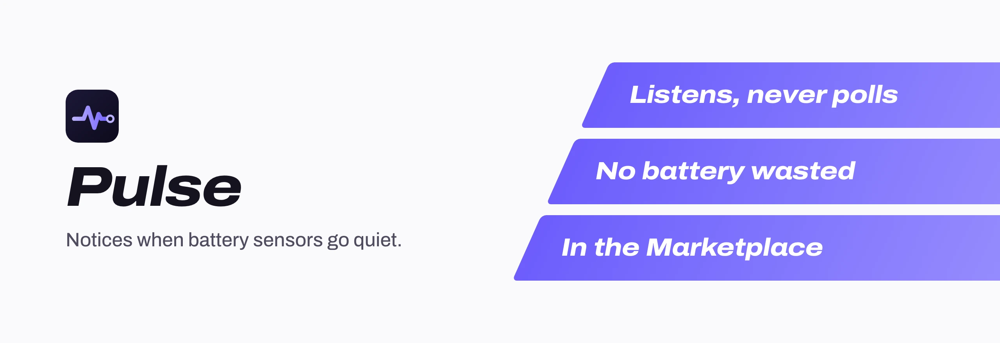
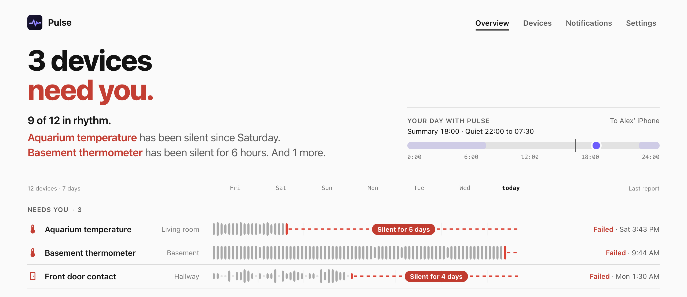
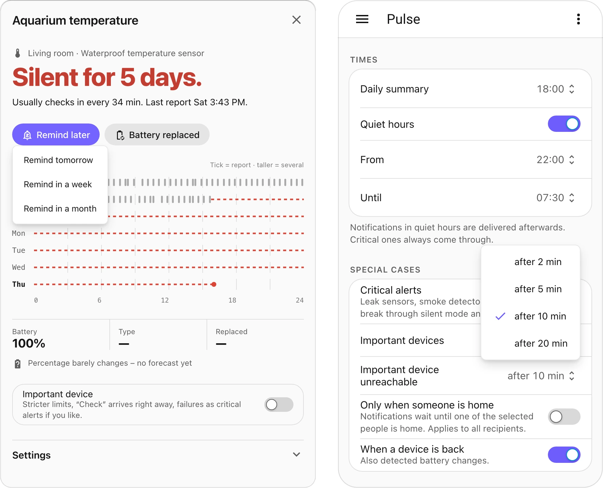

<div align="center">

<picture>
  <source media="(prefers-color-scheme: dark)" srcset="docs/images/readme-title-dark.webp" />
  
</picture>

[](https://github.com/SH1FT-W/pulse/releases/latest)
[](https://www.home-assistant.io)
[](https://hacs.xyz)

<a href="https://sh1ft-w.github.io/pulse"><b>Website</b></a>&emsp;<a href="#install">Install</a>&emsp;<a href="#set-up">Set up</a>&emsp;<a href="#notifications">Notifications</a>&emsp;<a href="#entities-events-and-actions">Entities</a>&emsp;<a href="CHANGELOG.md">Changelog</a>

</div>

<br/>

When a sensor dies, Home Assistant keeps showing the last state it heard: the door stays "closed", the battery stays at 94 %. Pulse looks at **how often each device talks**, learns its rhythm and tells you when one goes quiet, before an automation misfires. It reads 10 days of recorder history on the first start, so there is no learning week.

Pulse only listens. It never asks a device anything, so it costs no battery and no airtime. It notices that a device stopped talking, not that what it says is wrong: a sensor that keeps reporting the same wrong value counts as alive.

## When Pulse speaks up

| Status | Normal device | Important device (lock, leak, smoke, gas) |
|:--|:--|:--|
| **Good** | Reporting as usual | Reporting as usual |
| **Watch** | Silent for 2.5 × its typical gap (at least 45 min), or battery at 20 % or less | Silent for 2 × (at least 30 min) |
| **Check** | Silent for 4 × (at least 2 h), unreachable for 20 min, or battery at 10 % or less | Silent for 3 × (at least 1 h), unreachable for 10 min (2 to 20 min, you choose) |
| **Failed** | Silent for 8 × (at least 6 h), or unreachable for 2 h | Silent for 5 × (at least 3 h), or unreachable for 1 h |

Every status comes with a reason in plain words: *Silent for 5 days. Usually reports every 30 minutes.* Pulse needs about seven reports to know a rhythm; until then a device is *Learning*. Failed devices also show up under **Settings > Repairs** and disappear on their own when they report again.

<p align="center">
<picture>
  <source media="(prefers-color-scheme: dark)" srcset="docs/images/overview-dark.png" />
  
</picture>
</p>

**New in 26.11:** remind later in a week or a month, and you choose how fast an unreachable important device is reported. Every change is in the [changelog](CHANGELOG.md).

<a id="install"></a>
## Install

[](https://my.home-assistant.io/redirect/hacs_repository/?owner=SH1FT-W&repository=pulse&category=integration)

Search for **Pulse** under **Settings > Marketplace** (called HACS before Home Assistant 2026.11), download it and restart Home Assistant.

<details>
<summary>Install by hand</summary>

1. Download the [latest release](https://github.com/SH1FT-W/pulse/releases/latest).
2. Copy `custom_components/pulse` into `/config/custom_components/` and restart Home Assistant.

</details>

<a id="set-up"></a>
## Set up

Pulse needs Home Assistant 2026.9 or newer and nothing else. The Companion app (notifications), Zigbee2MQTT (signs of life) and the recorder (history and forecasts) are optional.

1. **Add the integration.** **Settings > Devices & services > Add integration > Pulse**. One click, Pulse finds your devices itself.
2. **Open Pulse in the sidebar.** The welcome sheet offers one switch for Zigbee signs of life (see [Zigbee2MQTT](#zigbee2mqtt)). Admins can change everything, other users see the panel read only.
3. **Mark what matters.** A star makes a device important (tighter limits, see above). Ignore what you never want to hear about.
4. **Send a test notification** under **Notifications** and check the recipients.

Which devices Pulse watches:

- **Battery devices:** every device with a battery sensor (`device_class: battery`), also one that only reports "battery low". Phones, tablets, vacuums, mowers and devices with power or energy sensors are skipped on purpose.
- **Mains-powered devices** (beta, on by default, **Settings > Watch mains-powered devices**): every device of a local integration (ZHA, Zigbee2MQTT, Z-Wave, Matter, ESPHome, Shelly, Hue, TP-Link, WLED and a few more), and from any other integration every device with a lamp, plug, switch, cover, fan, thermostat, valve or lock. Pulse reports one that is no longer reachable, or one that usually reports regularly and goes silent. A device that is often gone by itself (a console in standby) learns that as its habit: *Watch* without a notification, until it stays away for more than twice its longest outage.
- **Anything else by hand** under **Settings > Added by hand > Add device**: cameras, speakers, TVs, robot vacuums, a NAS. A connectivity sensor or a router's device tracker (UniFi, FRITZ!Box, Nmap) decides whether it is there, otherwise its main entities, and it is gone only while all of them are unavailable.

Pulse speaks English, German, French, Spanish and Dutch.

<a id="notifications"></a>
## Notifications

Through the Companion app (`notify.mobile_app_*`). New phones are added automatically as long as you don't change the recipient list.

- **Failed, Check and Battery** each go right away, in a daily summary, or not at all. Important devices send Check right away.
- **Quiet hours and "only when someone is home".** Only the latest message per device is kept; a device that failed and recovered at night sends nothing.
- **Critical alerts** break through Do Not Disturb when an important device fails.
- **Buttons in the notification:** Battery replaced, Remind tomorrow, Remind in a week.
- **One message for an outage.** Three or more devices silent in the same minute is a hub or bridge, not the batteries. The same for a cloud outage.

Under **Notifications > Texts** you can rewrite title and text of each kind, with a live preview and placeholders `{name}`, `{area}`, `{reason}`, `{model}`, `{manufacturer}`, `{integration}`.

<p align="center">
<picture>
  <source media="(prefers-color-scheme: dark)" srcset="docs/images/readme-screens-dark.webp" />
  
</picture>
</p>

<a id="zigbee2mqtt"></a>
## Zigbee2MQTT

Many sensors only send when a value changes. With one switch Pulse turns on `last_seen` and availability in the Zigbee2MQTT bridge, so it also sees reports that changed nothing. A second switch turns on the health check of Zigbee2MQTT 2.x: Pulse then notices devices that still talk to the network but no longer send values (at most *Check*).

These bridge options are the only things Pulse ever writes, and only after you confirm them in the panel. With availability on, Home Assistant shows silent Zigbee devices as unavailable, and Zigbee2MQTT pings mains-powered routers.

<a id="entities-events-and-actions"></a>
## Entities, events and actions

Attached as diagnostic entities to the monitored device itself:

| Entity | Shows |
|:--|:--|
| `binary_sensor.<device>_pulse_problem` | On for Check or Failed. Attributes `status`, `reason_key` |
| `sensor.<device>_pulse_status` | `ok`, `learning`, `watch`, `check`, `failed`. Attributes `reason_key`, `silent_since`, `problem_since`, `typical_interval` (s), `critical`, `snoozed_until` |
| `sensor.<device>_pulse_last_report` | Time of the last report. Disabled by default (one recorder row per report) |
| `sensor.pulse_problems` | Number of problems, attribute `devices` with `device_id`, `name`, `status`, `reason_key`, `reason` |
| `sensor.pulse_monitored_devices` | Number of monitored devices |

<details>
<summary>Events, actions, labels and reason keys</summary>

- **Events:** `pulse_device_status_changed` (`device_id`, `name`, `status`, `previous`, `reason`, `reason_key`; not for the first evaluation after a start) and `pulse_battery_replaced` (`device_id`, `name`, `source`: `manual`, `auto` or `announce`).
- **Actions:** `pulse.mark_replaced`, `pulse.snooze` (`hours`, 0 cancels), `pulse.ignore`, `pulse.send_test`, `pulse.send_summary` (response `sent`).
- **Labels:** the Home Assistant label `pulse_important` or `pulse_ignore` on a device or one of its entities wins over the panel switch; `pulse_ignore` wins over `pulse_important`. Ignored devices are unavailable.
- **`reason_key`:** `ok_rhythm`, `ok_reachable`, `learning`, `silent`, `silent_new`, `silent_strays`, `unavailable`, `partner`, `battery_low`, `battery_low_flag`, `battery_soon`, `battery_missing`, `radio_only`, `cloud_outage`, `startup_waiting`, `waiting_first`.

</details>

## Examples

Flash a light when a device fails, but not for a battery:

```yaml
triggers:
  - trigger: event
    event_type: pulse_device_status_changed
    event_data:
      status: failed
conditions:
  - condition: template
    value_template: "{{ not trigger.event.data.reason_key.startswith('battery') }}"
actions:
  - action: light.turn_on
    target:
      entity_id: light.hallway
    data:
      flash: long
```

## Your data

- **No cloud.** Pulse runs entirely inside Home Assistant: recorder, state changes, MQTT, Companion app. Nothing leaves your network.
- **Only listens.** It never causes radio traffic. The Zigbee2MQTT options are the only thing it writes, after you confirm.
- **Diagnostics without names.** The diagnostics download has the state of every monitored device, but no device names, recipients or persons.

## Good to know

- A device that only reports when something happens has no rhythm. It becomes *Watch* after two days without a report (no notification) and *Check* after a week.
- Devices added by hand only show whether they are there. A camera streaming a frozen picture looks fine.
- Notifications go only to the Companion app. For anything else, use the `pulse_device_status_changed` event.
- Forecasts need a battery level that falls in fine steps over at least two weeks. Coarse levels, NiMH rechargeables and "battery low" only devices get none, and the panel says why.
- Cloud integrations come from a fixed list (Netatmo, Ring, Nest, tado and others). One that is not on it is treated like a local one.

<details>
<summary>Troubleshooting</summary>

- **A device is missing.** Check that it has an enabled battery entity and is not one of the skipped kinds. Any device except phones can be added by hand.
- **A device shows Failed although it works.** Open it in the panel; the reason says what Pulse saw. If it reports rarely, give it a few days, change whether it is important, or ignore it.
- **No notifications.** Use **Send test notification** (or `pulse.send_test`) and check recipients and levels.
- **Debug log:**

  ```yaml
  logger:
    logs:
      custom_components.pulse: debug
  ```

When you open an [issue](https://github.com/SH1FT-W/pulse/issues), attach the diagnostics (**Settings > Devices & services > Pulse > three dots > Download diagnostics**).

</details>

<details>
<summary>Remove</summary>

1. **Settings > Devices & services > Pulse > three dots > Delete**. This removes the panel, the Pulse entities, open repairs and the stored data (`.storage/pulse.devices`).
2. If you turned on Zigbee signs of life, `last_seen` and availability stay on in Zigbee2MQTT. Switch them off there under **Settings > Advanced** and **Settings > Availability** if you don't want them.
3. Remove Pulse in the Marketplace and restart Home Assistant.

</details>

<details>
<summary>How it decides</summary>

From the gaps between reports Pulse learns a typical gap and a longest normal gap per device, and a daily pause (a light sensor that is silent every night). The current silence is compared with them.

| Rule | What Pulse does |
|:--|:--|
| Restart echoes | Values Home Assistant or Zigbee2MQTT replay after a restart never count as a sign of life. Time Home Assistant was not running never counts as silence. |
| Recovery | After a long silence, one stray report is not enough. Two reports in the usual rhythm or a real action (a door opening) are. |
| Reachable devices | If the integration says a device is reachable (Matter, a cloud connectivity sensor), a device that only reports on events stays fine. |
| Cloud devices | Only a real change of value counts. Several devices of one cloud going quiet together is a cloud outage: *Watch* and one message. |
| Partners | Devices that fire together (a lock and its door contact) cross-check each other. Pulse suggests partners itself. |
| Battery | Changes are detected from a voltage or level jump or a Zigbee re-join. A device's own "battery low" sensor wins over its percentage. NiMH rechargeables get no percentage warning. The forecast comes from long-term statistics. |

</details>

<details>
<summary>Development</summary>

```bash
cd frontend && corepack yarn install && corepack yarn build   # panel, built into custom_components/pulse/www
python -m pytest -q                                          # needs pytest-homeassistant-custom-component
dev/deploy-test.sh                                           # copy into a Docker test instance
```

`dev/pulse_fake` simulates a Zigbee2MQTT bridge (with `last_seen`, availability, restart echoes and battery changes) plus a few non-MQTT devices. `dev/seed_store.py` writes ten days of history for them. Quality scale: platinum, [self-assessed](custom_components/pulse/quality_scale.yaml).

</details>

## License

[Apache 2.0](LICENSE). Copyright 2026 SH1FT-W.

<sub>Pulse is an independent project and is not affiliated with Home Assistant or Nabu Casa.</sub>
